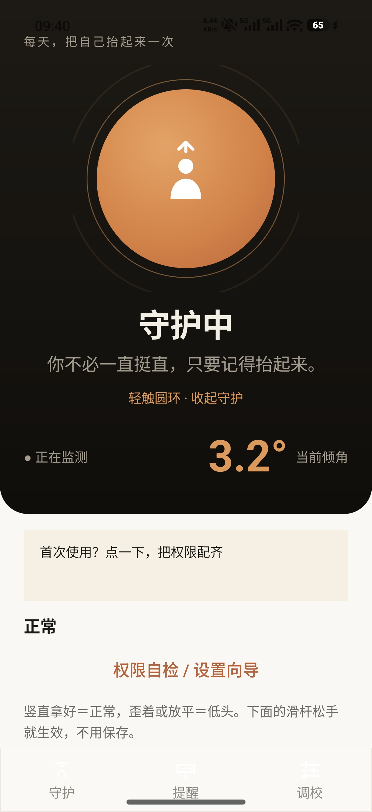
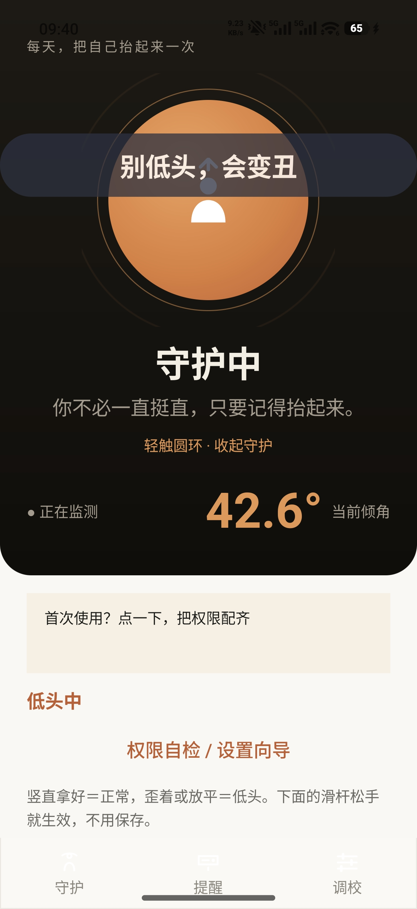

# 抬举 · Posture Guard

> 每天，把自己抬起来一次。

一个跑在 Android 手机上的「低头提醒」小工具。它不联网、不上传、不读通讯录和位置，只用手机自带的重力传感器判断你有没有低头；低头了就在屏幕上轻轻提醒你一下。

**这是一个用 AI 从零手搓出来的个人项目。** 没有公司、没有团队、没有商业模式，纯粹是把一个想法做出来分享给大家。觉得有用就 star 一下，或者把它改造成你自己想要的样子。

[English README](README_EN.md) · [下载 APK](apk/posture-guard-v1.3.apk) · [截图](#界面截图)

---

## 它解决什么问题

刷手机时不知不觉就埋着头，脖子僵、肩膀酸。这个 App 做的事很简单：

- 手机**相对竖直**拿着 → 认为你没低头，安静待着；
- 手机**歪了或快放平了** → 认为你低头了，持续几秒后提醒一下；
- 你**抬回竖直** → 提醒自动消失。

它判断的是「手机的姿态」，把它当作「你有没有低头」的代理量。这不是医学意义上的姿态检测，只是一个善意的小提醒。

## 界面截图

**正常状态 · 守护中（3.2°）**



**低头提醒 · 悬浮条弹出（42.6°）**



## 主要功能

### 第一页 · 守护（仪式感主开关）

- **巨型圆形主开关**：点一下开始守护，再点一下收起。开启后有呼吸光晕和「盖印章」式的回弹反馈。
- **每日一句**：7 条短句按日期轮换，比如「你不必一直挺直，只要记得抬起来。」
- **实时倾角**：大字显示当前角度（0° 竖直、90° 水平）。
- **提醒方式**：顶部悬浮条 / 通知横幅 / 提示音 / 震动 / 持续低头重复提醒，5 个独立开关。
- **监测范围**：锁屏时是否继续、平放桌面静默、开机自启、常驻通知按钮与文案等。

### 第二页 · 提醒（外观可调）

- 悬浮条文案可自己写，也内置 3 条预设（含「抬举一下，脖子谢谢您」「别埋着头啦～」）。
- 8 种底色预设，文字颜色按底色深浅自动切换；宽度、离顶端距离、圆角、字号都能拖动调节。
- 页内实时预览 + 「在真实屏幕上试一下」。

### 第三页 · 调校（参数拖动）

- 13 项算法参数全部改成小白能懂的描述 + 拖动条，不再有输入框和术语。
- 例如「多大角度算低头」「低头多久才提醒」「抬到哪算改好了」，每项都标了默认值，长按标题可恢复默认。
- 松手即生效，不用点保存。

### 判定逻辑（给好奇的人）

- 倾角 = 重力向量与「设备竖直参考轴」的夹角，**竖屏用长边 Y 轴、横屏用短边 X 轴**（横屏有自己的一套角度识别）。
- 40° 触发 / 30° 解除，双阈值滞回 + 3 秒去抖，避免误报。
- 近水平（≥78°）且几乎不动持续 1.5 秒 → 判定为「平放桌面」并静默。
- 只在**亮屏且已解锁**时采样；熄屏主动注销传感器，不加唤醒锁、不额外耗电。
- 横竖屏按**物理朝向**识别（由重力推算，与系统「自动旋转」开关无关），切换时重置判定窗口并撤掉残留提醒。

## 使用方法

### 1. 安装

直接下载 [apk/posture-guard-v1.3.apk](apk/posture-guard-v1.3.apk) 传到手机上安装。Android 10 及以上（minSdk 29）。

> 应用未上架应用商店，属于侧载安装。首次安装需要允许「安装未知来源应用」。

### 2. 首次打开：把权限配齐

小米 / HyperOS 会主动清理后台应用。第一次打开请点首页的「首次使用？点一下，把权限配齐」，按向导逐项确认 8 项设置，尤其是这 4 项**系统私有开关 App 无法读取也无法代开**：

1. 自启动
2. 省电策略设为「无限制」
3. 后台任务锁定
4. 后台弹出界面

不设置的话，手机重启或一键清理后台后可能就不再提醒了。其他权限（通知、悬浮窗、开机启动、通知读取）App 会引导你开启。

### 3. 点亮主开关

回到首页，点中间的圆形开关，状态变成「守护中」就好了。之后把手机竖直举到视线高度试试。

### 4. 日常使用

- 低头 → 悬浮条 + 通知横幅提醒（可按需关掉其中任何一个）。
- 抬回竖直 → 提醒消失。
- 临时不想被打扰 → 常驻通知上的「暂停」，或第三页里的「暂停 N 分钟」按钮。

## 隐私与权限

- **完全离线**：不联网、没有网络权限、不上传任何数据。
- **只用重力传感器**判断姿态，不读通讯录 / 位置 / 文件。
- 申请的权限只有 7 条，全部是功能必需：前台服务、前台服务 specialUse、震动、开机启动、忽略电池优化、通知、悬浮窗。
- 常驻通知是 Android 对前台服务的强制要求，**无法关闭**；能关的只是通知上的按钮和详细文案。

## 自己编译

```bash
# 环境：JDK 17 + Android SDK 35 + Gradle 8.9
# 方式一：用 Android Studio 打开本目录，Build > Build APK(s)
# 方式二：设置 JAVA_HOME 与 ANDROID_HOME 后
./gradlew assembleDebug

# 纯 JVM 状态机自测（不需要 Android SDK，17 条断言）
双击 跑测试.bat   # Windows
# 或：
javac -encoding UTF-8 -d out \
  app/src/main/java/com/example/posture/PostureDetector.java \
  jvmtest/PostureDetectorSelfTest.java
java -Dfile.encoding=UTF-8 -cp out com.example.posture.PostureDetectorSelfTest
```

仓库**不含签名私钥**。若你有自己的 keystore，把它放到 `keystore/posture.jks` 并按 `app/build.gradle` 里的别名/密码配置即可产出签名包；没有也能正常编译出未签名包。

## 项目结构

```
.
├── app/src/main/java/com/example/posture/
│   ├── PostureDetector.java   # 纯 JVM 姿态判定状态机（零 android.* 依赖）
│   ├── PostureService.java    # 前台服务、传感器、提醒调度、物理朝向判定
│   ├── MainActivity.java      # 三页界面、仪式开关、参数拖动
│   ├── Prefs.java             # 全部开关与参数的本地存储
│   ├── NotifyHelper.java      # 通知渠道与横幅
│   ├── OverlayReminder.java   # 悬浮条（含页内预览共用）
│   └── GuideActivity.java     # 8 项权限自检向导
├── app/src/main/res/          # 布局、drawable、中英文文案与设计令牌
├── jvmtest/                   # 17 条纯 JVM 自测
├── screenshots/               # 界面截图
└── apk/                       # 已签名安装包
```

技术栈：纯 Java + Android 原生 View，**零第三方依赖**，不用 Kotlin / Compose / AndroidX。编译用 AGP 8.7.3 + Gradle 8.9 + JDK 17，minSdk 29 / targetSdk 35。

## 关于这个项目

代码是和 AI 一起，从一句「帮我做个提醒我别低头看手机的应用」开始，一轮一轮聊出来的：先定姿态判定状态机，再补全量开关，再做悬浮条外观编辑，然后修横屏识别的 bug，最后把页面拆成三页并做了这个仪式感主开关。没有产品文档、没有设计稿、没有测试用例评审——就是一个想法被手搓出来的过程。

所以：**纯分享想法**。如果你拿去改了、用了、或者由此做了别的东西，都挺好。 star 一下就更好了。

## 免责声明

- 本应用仅供个人学习与日常提醒使用，**不是医疗设备**，不具备医疗诊断或治疗功能。
- 姿态判断基于手机传感器，受持机方式、传感器差异、系统省电策略影响，**可能漏报或误报**。
- 作者不对因使用本应用造成的任何损失负责。侧载安装风险请自行评估。
- 请开车、骑行、行走时不要操作手机；本应用也不能替代正确的坐姿与休息。

## 许可证

[MIT](LICENSE) —— 随便用，注明出处即可。

---

如果这个项目让你抬了一次头，那它就已经值回票价了。
