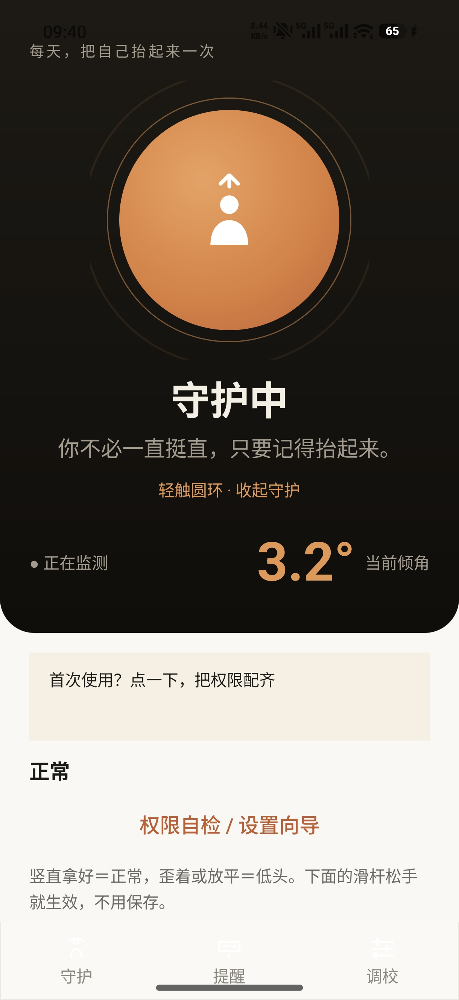
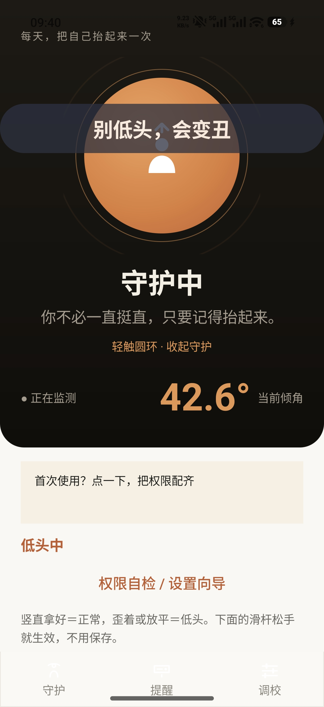

# 抬举 (Posture Guard)

> Lift yourself up, once a day.

> ⚠️ **Platform note**: **Android only** at the moment. Development and testing were done on a **Xiaomi 17 running HyperOS**; there is **no iOS version**. Other Android brands can sideload the same APK, but the OEM-specific switches in the setup guide need to be located in that brand's own settings. iOS is unlikely to happen due to system restrictions.

A tiny "don't slouch" reminder for Android. No network, no uploads, no contacts or location access — it only uses the built-in gravity sensor to guess whether you are looking down, and gives you a gentle nudge when you are.

**This project was hand-built from scratch with AI.** No company, no team, no business model — just an idea I wanted to exist, shared with you. Star it if it helps, or fork it and turn it into something you actually want.

[中文说明](README.md) · [Download APK](apk/posture-guard-v1.3.apk) · [Screenshots](#screenshots)

---

## The problem

You scroll on your phone and quietly sink into a hunched posture. Neck stiff, shoulders sore. This app does something simple:

- Phone held **roughly upright** → you are fine, it stays quiet.
- Phone **tilted or nearly flat** → it considers you slouching, and reminds you after a few seconds.
- You **lift the phone back upright** → the reminder goes away.

It uses the phone's orientation as a *proxy* for your posture. This is not medical posture tracking — just a friendly little nudge.

## Screenshots

<table>
  <tr>
    <td align="center" width="50%"><b>Normal · guard on (3.2°)</b><br></td>
    <td align="center" width="50%"><b>Slouch detected · banner (42.6°)</b><br></td>
  </tr>
</table>

## Features

### Page 1 · Guard (the ritual)

- **Giant circular main switch**: tap to start guarding, tap again to stop. A breathing halo and a stamp-like bounce make it feel deliberate.
- **A line a day**: seven short lines rotate by date, e.g. "You don't have to stay perfectly straight — just remember to lift yourself up."
- **Live tilt angle**: a big number showing the current angle (0° upright, 90° flat).
- **Reminder channels**: floating bar / notification banner / sound / vibration / repeat while slouching — five independent switches.
- **Monitoring scope**: monitor while locked, silence when laid flat, start on boot, and notification button/text options.

### Page 2 · Reminders (make it yours)

- Write your own overlay text, or pick from three presets.
- Eight background colors; text color flips automatically for readability. Width, vertical offset, corner radius and text size are all drag-to-adjust.
- Live in-page preview plus "try it on the real screen".

### Page 3 · Tuning (plain language, sliders)

- All 13 algorithm parameters are described in everyday language with sliders — no input boxes, no jargon.
- Things like "How much tilt counts as slouching", "How long before it reminds you", "How upright is good enough". Every item shows its default; long-press the title to reset it.
- Changes apply the moment you release the slider. No save button.

### How it decides (for the curious)

- Tilt angle = angle between the gravity vector and the device's **upright reference axis**: the long Y axis in portrait, the short X axis in landscape (landscape has its own angle logic).
- 40° to trigger / 30° to clear, with hysteresis and a 3-second debounce.
- Near-horizontal (≥78°) and almost motionless for 1.5 seconds → treated as "lying on a desk" and silenced.
- Sampling only while the screen is on and unlocked; the sensor is unregistered on screen-off. No wake lock, no extra battery drain.
- Portrait/landscape is inferred from **physical orientation** (derived from gravity, independent of the system auto-rotate toggle). Switching resets the detection window and clears any lingering reminder.

## How to use

### 1. Install

Download [apk/posture-guard-v1.3.apk](apk/posture-guard-v1.3.apk), copy it to your phone and install. Android 10+ (minSdk 29).

> This app is not on the Play Store — it is sideloaded. You may need to allow "install unknown apps" the first time.

### 2. First launch: grant the permissions

Xiaomi / HyperOS aggressively kills background apps. On first launch, tap "First time here? Tap to set up permissions" and go through the 8-item guide. Pay special attention to these four **OEM-specific switches the app cannot read or enable for you**:

1. Autostart
2. Battery usage set to "Unrestricted"
3. Lock background tasks
4. Allow background pop-ups

Without them, the app may stop reminding you after a reboot or a one-tap cleanup. Other permissions (notifications, overlay, boot, notification access) are requested through the guide.

### 3. Light up the ring

Back on the home page, tap the circular switch. It should say "Guarding". Hold the phone upright at eye level and give it a try.

### 4. Day to day

- Slouch → floating bar + notification banner (either can be disabled independently).
- Lift back upright → reminder disappears.
- Need a break → use the "Pause" action on the persistent notification, or the "Pause N minutes" button on page 3.

## Privacy & permissions

- **Fully offline**: no network permission, nothing is uploaded.
- Only the gravity sensor is used for orientation; no contacts, location or file access.
- Exactly 7 permissions, all required: foreground service, special-use foreground service, vibration, boot completed, ignore battery optimizations, post notifications, system alert window.
- The persistent notification is mandatory for Android foreground services and **cannot be turned off**; only its buttons and detailed text can be configured.

## Build it yourself

```bash
# Requirements: JDK 17 + Android SDK 35 + Gradle 8.9
# Option 1: open this folder in Android Studio -> Build > Build APK(s)
# Option 2: set JAVA_HOME and ANDROID_HOME, then
./gradlew assembleDebug

# Pure-JVM state-machine tests (no Android SDK needed, 17 assertions)
# Windows: run 跑测试.bat  (set JAVA_HOME first)
javac -encoding UTF-8 -d out \
  app/src/main/java/com/example/posture/PostureDetector.java \
  jvmtest/PostureDetectorSelfTest.java
java -Dfile.encoding=UTF-8 -cp out com.example.posture.PostureDetectorSelfTest
```

The repository **does not contain a signing key**. If you have your own keystore, drop it at `keystore/posture.jks` and match the alias/password in `app/build.gradle` to produce a signed build; without it you can still build an unsigned debug APK.

## Project layout

```
.
├── app/src/main/java/com/example/posture/
│   ├── PostureDetector.java   # pure-JVM posture state machine (zero android.* imports)
│   ├── PostureService.java    # foreground service, sensors, reminders, orientation
│   ├── MainActivity.java      # three pages, ritual switch, sliders
│   ├── Prefs.java             # local storage for all switches and parameters
│   ├── NotifyHelper.java      # notification channels and banners
│   ├── OverlayReminder.java   # floating bar (shared with in-page preview)
│   └── GuideActivity.java     # 8-item permission checklist
├── app/src/main/res/          # layouts, drawables, strings, design tokens
├── jvmtest/                   # 17 pure-JVM assertions
├── screenshots/               # UI screenshots
└── apk/                       # signed release APK
```

Stack: pure Java + native Android Views, **zero third-party dependencies** — no Kotlin, Compose or AndroidX. Built with AGP 8.7.3, Gradle 8.9, JDK 17; minSdk 29 / targetSdk 35.

## About this project

This was built with AI, starting from a single sentence: "make an app that reminds me not to look down at my phone." One round at a time: first the posture state machine, then all the toggles, then the overlay editor, then a landscape-detection bug fix, and finally splitting the UI into three pages with that ritual switch. No spec doc, no design mockups, no test reviews — just an idea, hand-built.

So: **shared purely as an idea.** If you use it, modify it, or build something else from it, that's great. A star would be even better.

## Disclaimer

- This app is for personal learning and casual reminders. It is **not a medical device** and provides no diagnosis or treatment.
- Posture detection relies on phone sensors and can be affected by how you hold the phone, sensor differences and OS battery policies. **False positives and misses are possible.**
- The author is not liable for any loss arising from use. Evaluate sideloading risks yourself.
- Please don't operate your phone while driving, cycling or walking. This app is no substitute for good posture and regular breaks.

## License

[MIT](LICENSE) — use it however you like, just keep the attribution.

---

If this app made you lift your head once, it already paid for itself.
